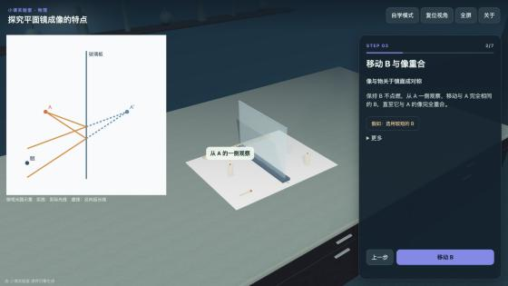
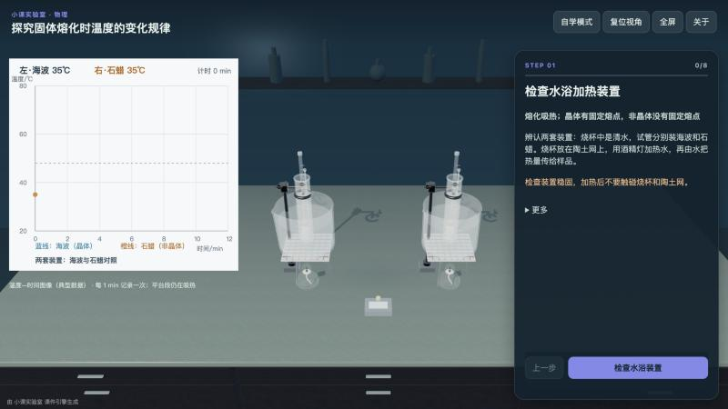
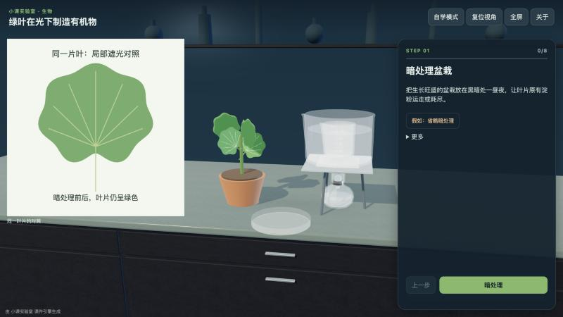
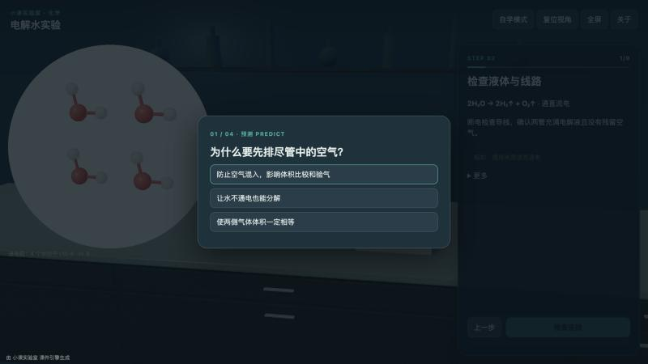

# 小课实验室 · 实验课件 Skill（xiaoke-lab）

让 AI Agent 一句话生成**可交互的 3D 中小学理化生实验课件**，输出一个可离线打开的 HTML 文件。

> “帮我做一个八年级物理『探究平面镜成像的特点』的实验课。”

| 平面镜成像（物理） | 固体熔化（物理） |
|---|---|
|  |  |
| **绿叶在光下制造有机物（生物）** | **电解水（化学）** |
|  |  |

## 生成的课件有什么

- **写实 3D 实验台与器材**：试管、酒精灯、铁架台、烧杯、锥形瓶、光具座、显微镜、学生电源、温度计、盆栽……可按步骤操作。
- **预测—观察—解释**：关键现象出现之前先让学生预测，干扰项来自真实的错误观念。
- **“假如这样做”**：演示常见错误操作的后果（倒吸、炸裂、压碎玻片……），看完可一键倒带。
- **看见看不见的**：化学用粒子视图（分子拆开、原子重组、原子守恒），物理用光路图或数据图，生物用显微镜视野。
- **课堂 / 自学两种模式**、现象记录、实验小结。
- 手机横屏、平板、电脑、教室大屏都能用，有全屏按钮；单个 HTML 文件约 2.3 MB，**不联网也能打开**。

## 安装

本仓库根目录就是 Skill 本身（`SKILL.md` 在根目录）。把它放进你所用 Agent 的 skills 目录即可，例如：

```bash
# Claude Code
git clone https://github.com/xiao-class/xiaoke-lab-skill ~/.claude/skills/xiaoke-lab

# WorkBuddy
git clone https://github.com/xiao-class/xiaoke-lab-skill ~/.workbuddy/skills/xiaoke-lab
```

其他支持 `SKILL.md` 的 Agent 平台同理；也可以下载 ZIP，解压后放进对应目录（或在支持上传 Skill 的平台上传 ZIP）。

**运行要求**：Node.js ≥ 18。不需要 `npm install`，不需要联网，不需要浏览器。

## 使用

直接对 Agent 说你要的实验课即可，例如：

- “帮我做一个九年级化学『电解水实验』的实验课。”
- “做一个七年级生物『练习使用显微镜』的虚拟实验。”
- “人教版八年级物理，凸透镜成像规律，做成 3D 实验课。”

Agent 会按 `SKILL.md` 的流程：核对科学内容 → 设计步骤、预测与“假如” → 写课件配置 → 校验 → 预览自查 → 打包成 HTML。

也可以手动使用脚本：

```bash
node scripts/new-course.mjs --id plane-mirror --subject physics --title "探究平面镜成像的特点" -o plane-mirror.js
node scripts/validate-course.mjs plane-mirror.js          # 走完全部步骤、预测、假如与倒带，并做几何与取景检查
node scripts/preview-course.mjs plane-mirror.js --all --out preview.png   # 无浏览器渲染每一步的示意图
node scripts/build-course.mjs plane-mirror.js -o plane-mirror.html        # 打包成单个离线 HTML
```

把 `examples/` 里任一范例打包，就能看到完整课件：

```bash
node scripts/build-course.mjs examples/water-electrolysis.js -o water-electrolysis.html
```

## 目录

| 路径 | 内容 |
|---|---|
| `SKILL.md` | Agent 读取的主流程 |
| `reference/` | 配置格式与 API、器材/现象/交互/视图说明、自定义器材建模、教学设计规范、视觉自查清单 |
| `examples/` | 10 个完整课件：木炭还原氧化铜、一氧化碳还原氧化铁、高锰酸钾制氧气、二氧化碳制取与性质、电解水、凸透镜成像、平面镜成像、固体熔化、练习使用显微镜、绿叶在光下制造有机物 |
| `scripts/` | 新建、校验、预览、打包（零依赖 Node 脚本） |
| `runtime/` | 预构建的 3D 运行时（基于 three.js）与 CC0 材质资源 |
| `templates/` | 课件配置模板 |

## 说明

- 课件内容由 AI 生成。Skill 会要求 Agent 核对科学内容并通过校验，但**上课前请老师过一遍**，尤其是数值、方程式和安全提示。
- 生成的课件页脚默认有一行小字“由 小课实验室 课件引擎生成”，可在课件配置里设 `credit: false` 关闭。
- 本仓库由「小课实验室」小程序项目中的实验引擎导出。

## English

**xiaoke-lab** is an agent skill that turns a request like *"make an interactive lab lesson on the electrolysis of water for grade 9"* into a single offline HTML file: a realistic 3D lab bench with step-by-step operation, predict–observe–explain cards, "what if you do it wrong" consequence demos with rewind, and a second view (particles, ray diagrams, microscope field, data plots). Content is aimed at Chinese middle-school chemistry, physics and biology curricula. Requires only Node.js ≥ 18 — no install, no network, no browser. Drop this repository into your agent's skills directory and ask for a lab lesson.

## 许可

代码以 [MIT License](LICENSE) 发布。第三方组件与素材见 [CREDITS.md](CREDITS.md)。
